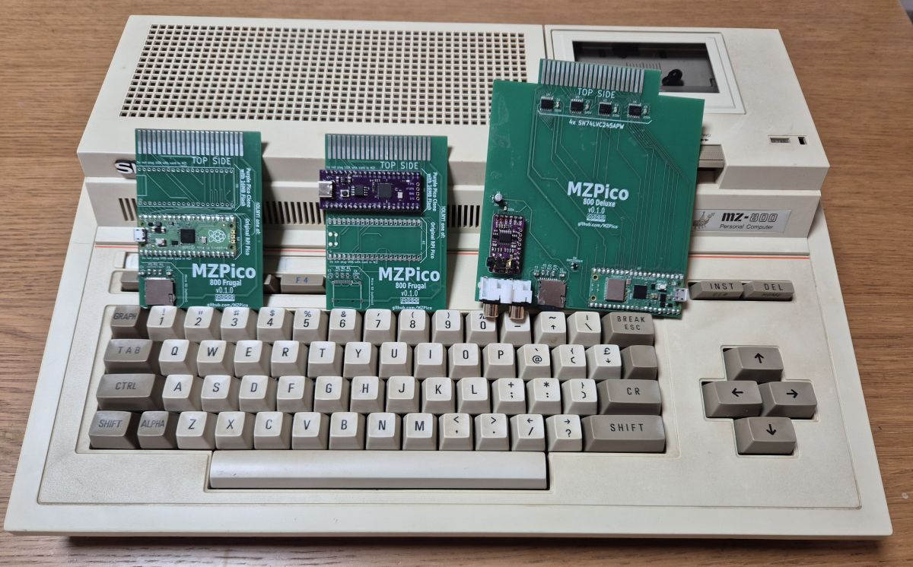
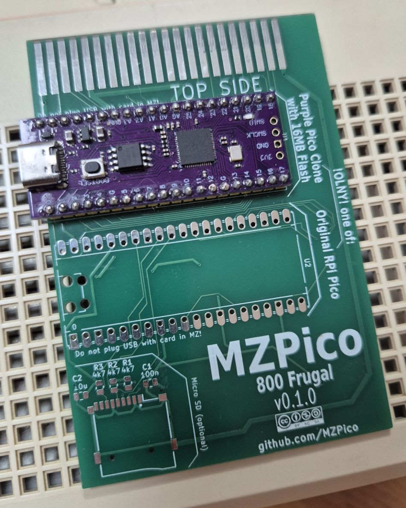
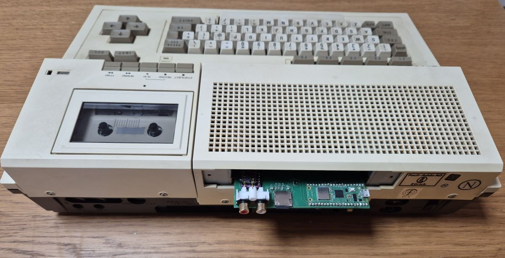
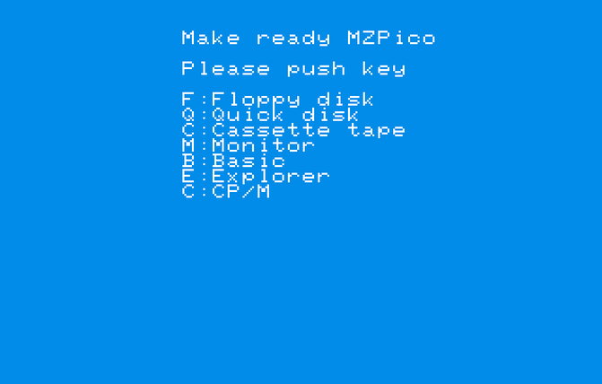
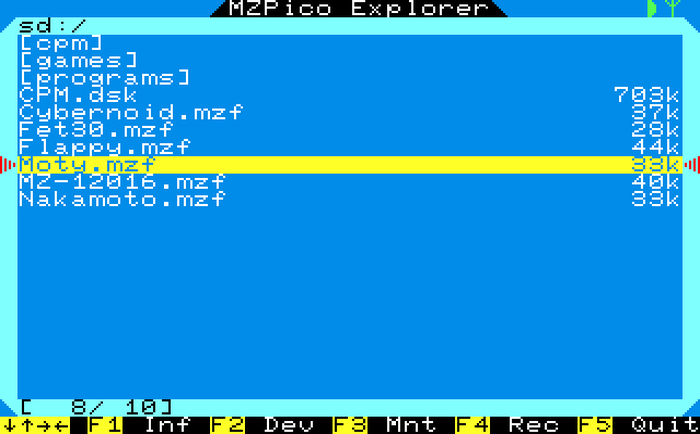

# MZPico Firmware

## What is MZPico?
**MZPico** is a modern replacement firmware and hardware platform for the **Sharp MZ-800**, powered by a **Raspberry Pi Pico**.  
This repository contains the firmware that controls the system.

Related hardware:


| Board | Status | Notes |
|--------|--------|-------|
| [Frugal Board](https://github.com/MZPico/MZPico-800-Frugal-Board) | ✅ Supported | Minimal build with optional MicroSD slot, limited to 8-bit address bus |
| [Deluxe Board](https://github.com/MZPico/MZPico-800-Deluxe-board) | ✅ Supported | Fits MZ-800 upper slot rails, adds level shifters, I2S sound card, Pico access for optional wireless connection |

---

## Features

- **Flexible file storage options**  
  Supports internal flash memory and optional MicroSD cards.

- **Native program execution**  
  Directly loads and runs:
  - `.MZF` (MZ program files)
  - `.DSK` (Floppy images)
  - `.MZQ` (Quick Disk images)

- **Storage device emulation**  
  Emulates multiple virtual devices:
  - Floppy disk controller
  - Quick disk
  - RAM disks (SRAM boot disk, paged RAM disk, PicoRD)

- **Sound emulation over I2S** *(Deluxe board)*  
  Both MZ-800 sound sources are rendered to the on-board I2S sound card:
  - **SN76489 PSG** — 3 tone channels + noise, stereo panning
  - **8253 beeper** — monitor beeps, MZ-700 melody and S-BASIC `MUSIC`, and 1-bit "beeper engine" music in games; both the I/O-mapped and the memory-mapped 8253 access paths are captured

- **User-friendly navigation interface**
  - **Customizable boot screen** with quick access to favorite programs  
    

  - **File explorer** supporting multiple storage devices, directory trees, and fast search  
    

    Cursor keys and `A`–`Z` search select, `CR` runs; `F1`–`F5` and the SHIFT
    combinations cover file info, mounting into any drive, recent launches,
    file operations and adding a file to the boot menu (see the footer).

- **Fast system boot via SRAM emulation**
  Allows instant startup on the MZ-800:
  - Boot via port `0xF8` on cold start or reset
  - Startup via port `0xF8` or `0xA8` using the `EB` command at the monitor prompt

- **Highly configurable**
  - Simple **INI-style configuration file**
  - Separate configuration section for each device type
  - Define custom base I/O ports per device
  - Supports multiple instances of the same device (e.g., multiple floppy controllers on different ports)
  - Any device can be enabled/disabled individually  
    → Supports very flexible hardware configurations and avoids conflicts with other expansions

- **Modular firmware architecture**
  Written in modern C++ and structured to make adding new devices and features easy.

- **Easy firmware update**
  - Uses Pico USB mass-storage upload (no special programmer required)
  - Flash and MicroSD contents remain untouched when updating firmware

- **WiFi and cloud storage support** *(Requires Raspberry Pi Pico W)*
  - Connect to WiFi networks
  - Browse and load files from cloud storage
  - Access cloud files as a virtual device `cloud:/`
  - Simple WiFi credential configuration via INI file

---

## Getting Started

1. Download the latest release from the  
   👉 **[Releases page](https://github.com/MZPico/MZPico-firmware/releases)**

2. Choose the correct firmware file:

| Board Type | Pico Model | Flash Size | Firmware File |
|------------|------------|------------|---------------|
| Frugal Board | Pico | 2MB | `mzpico_frugal_2m.uf2` |
| Frugal Board | Pico W (WiFi) | 2MB | `mzpico_frugal_2m_w.uf2` |
| Frugal Board | Purple Pico clone | 16MB | `mzpico_frugal_16m.uf2` |
| Deluxe Board | Pico | 2MB | `mzpico_deluxe_2m.uf2` |
| Deluxe Board | Pico W (WiFi) | 2MB | `mzpico_deluxe_2m_w.uf2` |

> 💡 **Note:** Use the `*_w.uf2` variants when using a Raspberry Pi Pico W to enable WiFi and cloud features.

3. Hold **BOOTSEL** on the Pico and connect to USB.
4. Copy the `.uf2` file to the Pico drive.
5. Upload your Sharp MZ-800 software to the MZPico card using USB mass storage.
6. Insert the card to a Sharp MZ-800 slot, switch it on - done!

---

## Configuration

MZPico uses a simple **INI-style configuration file** (`mzpico.ini`). At boot it is looked up on the **SD card first** (`sd:/mzpico.ini`), then on internal flash (`flash:/mzpico.ini`). Keep a copy on the SD card — it lets the machine boot even if the flash volume ever fails to mount.  
This file defines which virtual devices are enabled, their I/O base ports, and which storage images they use. Formatting the internal flash (with the `mzpico_format` UF2, or automatically on first USB use of a blank flash) writes a commented default `mzpico.ini` with every device section present and the most common options shown commented out — this README is the full option reference.

### General rules

- If a section exists in the file, **the device is enabled**  
  (unless the section contains `enabled=false`)
- Multiple instances of the same device type are allowed  
  Example: `[fdc1]`, `[fdc2]`, `[qd1]`, `[qd2]`, etc.  
  (The instance name is the device type plus trailing digits — the type itself never ends in a digit.)
- Each instance must use a **unique not overlapping ports using `base_port`**
- Instead of `base_port`, explicit `read_ports=` / `write_ports=` lists may be given (comma-separated, decimal or `0x` hex). The list lengths must match the device's port count exactly, or boot halts
- Built-in images can be referenced using `@name`

### Defaults (used when not specified)

| Device      | Default `base_port` |
|-------------|----------------------|
| `sramdisk`  | `0xf8` |
| `qd` (QuickDisk) | `0xf4` |
| `fdc` (Floppy Disk Controller) | `0xd8` |
| `pico_rd` (MZPico-type PicoRD RAM-disk) | `0x45` |
| `pico_mgr` (MZPico management device, Unicard-compatible protocol) | `0x50` |
| `psg` (SN76489 PSG) | `0xf2` |
| `ramdisk` (paged RAM disk) | `0xe9` (reset port fixed at `0xf8`) |
| `ctc` (8253 beeper) | fixed system ports (`base_port` not applicable) |

Default `enabled=true` for all devices.

### Board support

| Device | Frugal | Deluxe |
|--------|--------|--------|
| `sramdisk`, `qd`, `fdc`, `pico_rd`, `pico_mgr` | ✓ | ✓ |
| `ramdisk`, `psg`, `ctc` | — | ✓ |

`psg` and `ctc` need the Deluxe board's I2S sound output (`ctc` additionally its memory-write snooping). `ramdisk` needs the Deluxe bus capture for its 16-bit random-access positioning — what real MZ-1R18 software uses — so it is Deluxe-only (use `pico_rd` for a RAM disk on Frugal).

A configured device that the board cannot support is **skipped at boot**: the machine boots normally and the device is simply absent (missing from the explorer's device list) — the same behavior as when a device's buffers do not fit in RAM (see *RAM budget*). The same `mzpico.ini` can therefore be shared between boards.

### Built-in images (`@...`)

| Built-in image | Description |
|----------------|-------------|
| `@basic`     | Sharp MZ-800 BASIC with QD and PicoRD support|
| `@menu`      | MZPico boot menu |
| `@explorer`  | MZPico file explorer |

Images can also point to:
- `flash:/filename.ext`
- `sd:/filename.ext`

Supported extensions: `.MZF`, `.DSK`, `.MZQ`

### Menu section

The `[menu]` section configures quick-access programs on the boot menu.
Entries can also be added from the explorer (SHIFT+F5 on a file), which
writes them into the `mzpico.ini` that was loaded (`sd:/` or `flash:/`).

Format:

```
key_<letter>=<display text>|<image or file to execute>
```

Example:

```ini
[menu]
key_b=Basic|@basic
key_e=Explorer|@explorer
key_y=Flappy|flash:/flappy.mzf
key_p=CP/M|flash:/cpm.dsk
```

### Quick disk images

Quick disk emulation can use either a MZQ image file or a directory.
MZF files inside the directory (other files are ignored) are then served as
the content of the emulated Quick Disk. The order of files in the Quick Disk
is the same as their order in the MZPico device filesystem.

Directory-backed Quick Disks are fully writable: saving from the MZ-800
creates a real `.mzf` file in the directory (the filename is taken from the
saved Sharp file name, converted to ASCII; saving an existing name
overwrites that file), and formatting the Quick Disk deletes all MZF files
in the directory. An MZQ image is written in place. Either mount type
becomes read-only when `write_protected` is set; an MZQ image is also
protected by its FAT read-only attribute.

Options:
- `image` — MZQ file or directory
- `write_protected` — `true`/`false` (default `false`)

Example:
```ini
[qd]
image=sd:/qddir
```

### Floppy disk controller

The `[fdc]` section emulates the MZ-800 floppy disk controller with up to 4 drives. Each drive is assigned a `.DSK` image:

```ini
[fdc]
image_disk1=flash:/cpm.dsk
image_disk2=sd:/games.dsk
write_protected=false     ; default for all drives
write_protected1=true     ; per-drive override (1..4, matches image_disk1..4)
```

Sector reads and writes, multi-sector transfers, track formatting
(WRITE TRACK) and the READ TRACK verify pass are supported; formatting
rebuilds the DSK image in place and can create a fresh disk from an
empty image file.
A write-protected drive rejects write commands and reports the WD1793
write-protect status bit to the host, like a disk with the notch covered.
`write_protected` sets the default for all four drives and
`write_protected<N>` overrides it per drive. A drive also becomes
write-protected automatically when its image file has the FAT read-only
attribute set or sits on a write-protected medium.

#### Directory-mounted floppy

A drive can also point at a **directory** instead of a DSK image. The
directory is presented to the MZ-800 as a synthesized floppy in one of two
on-disk formats:

- `basic` — a Sharp Disk BASIC (MZ-2Z046) disk, 320 KB. The `.mzf` files
  in the directory appear as its files (up to 63).
- `cpm` — an LEC CP/M 2.2 SD data disk, 720 KB. All files in the
  directory appear under 8.3 names (up to 128 directory entries).

```ini
[fdc]
image_disk2=sd:/floppy/basic     ; a directory mounts as a disk
fs_disk2=basic                   ; or cpm; omit to auto-detect
```

`fs_disk<N>` selects the filesystem; without it, a directory containing
`.mzf` files mounts as `basic`, anything else as `cpm`. One directory can
be mounted on one drive at a time.

Directory mounts are fully writable: files saved by BASIC or copied under
CP/M appear as real files in the directory moments after the guest updates
the disk's directory, deletes and renames are mirrored, and **formatting
the disk deletes all served files** (like directory-backed Quick Disks).
The disk advertises only as much free space as the backing medium really
has, and a write that cannot be stored physically reports a disk error to
the guest instead of pretending success.

Limitations: directory-mounted disks are not bootable (boot the system
from a DSK image or another device and use the dir mount as a data disk);
BASIC BRD random-access files are not supported; CP/M file sizes round up
to 128-byte records; long or exotic filenames are shortened for CP/M.
Writable directory mounts work best on `sd:/` — flash makes every save
pay the flash filesystem's sync cost.

### Notes

- Any device can be disabled using `enabled=false`
- Configuring multiple devices is supported, as long as each has non-conflicting ports
- If a section does **not** exist in the `.ini` file, it will be disabled
- Keep a copy of `mzpico.ini` on the SD card: if the internal flash ever
  fails to mount, an SD-based config lets the MZPico boot with flash
  unavailable instead of halting
- The MZ-800 reset button performs a fast in-place reset: the WiFi
  connection survives and images mounted from the explorer are unmounted
  (images configured in `mzpico.ini` stay). Press reset **twice within a
  few seconds** to force a full MZPico restart instead
- The internal `flash:` storage is best for images that change rarely.
  Bulk-write workloads (e.g. formatting a floppy image) are inherently
  several times slower on `flash:` than on `sd:` — prefer the SD card for
  working disks
- The internal flash filesystem is protected against power loss during
  writes (double-buffered metadata). Volumes created by older firmware
  keep working but lack this protection; back up the files and reformat
  (e.g. with the `mzpico_format` UF2) to upgrade. A damaged flash volume
  is never reformatted automatically — over USB it shows as "no medium"

### PSG (SN76489)

The Programmable Sound Generator (PSG) emulates the Texas Instruments SN76489 used in Sharp MZ-800. It provides 3 tone channels and 1 noise channel, mixed to stereo with per-channel panning. **Deluxe board only** (needs the I2S sound output) — on Frugal the section is skipped at boot.

Config section name: `[psg]`

Defaults:
- `base_port=0xf2`
- `enabled=true`
- `tone0_pan=20`
- `tone1_pan=80`
- `tone2_pan=40`
- `noise_pan=60`
- `volume=20`

Panning keys (0–100):
- `tone0_pan` — left/right balance for tone channel 0
- `tone1_pan` — left/right balance for tone channel 1
- `tone2_pan` — left/right balance for tone channel 2
- `noise_pan` — left/right balance for noise channel

Master volume
- `volume` - volume level, 0-100

Example:

```ini
[psg]
base_port=0xf2
enabled=true
tone0_pan=0
tone1_pan=100
tone2_pan=0
noise_pan=100
volume=60
```

---

### CTC (8253 beeper)

Emulates the MZ-800 built-in beeper — the 8253 counter 0 with its gate latch and the 8255 audio mask — rendered to the I2S output. **Deluxe board only** — on Frugal the section is skipped at boot. Both hardware access paths are captured:

- the **I/O-mapped** ports used in MZ-800 mode (`0xd0`–`0xd7`)
- the **memory-mapped** window at `0xE004`–`0xE008`, used by MZ-700-mode software and many games (captured by snooping memory writes on the bus, with bank-switch tracking so RAM banked over the window never produces sound)

This covers monitor beeps, S-BASIC `MUSIC`, MZ-700 melody, chip-music engines, and 1-bit "beeper engine" sound in games (e.g. ZX Spectrum ports), reproduced with microsecond event timing.

Config section name: `[ctc]`

Defaults:
- `enabled=true`
- `volume=20` (matches the PSG default, so both sources are balanced)
- `pan=50`

Ports are fixed system addresses; `base_port` does not apply.

Example:

```ini
[ctc]
volume=20
pan=50
```

> 💡 **Note:** the power-on beep right after reset plays before MZPico's audio pipeline has started; it is heard only from the machine's internal speaker.

---

### RAM disk (paged)

The `[ramdisk]` section emulates a paged RAM disk: 64 KB pages selected via the page register, byte access with auto-increment (the address wraps inside its 64 KB page), and full 16-bit intra-page addressing on writes. Backed by Pico RAM, or by a file for persistent content. **Deluxe board only** (the 16-bit positioning that real MZ-1R18 software uses needs the Deluxe bus capture) — on Frugal the section is skipped at boot; use `pico_rd` for a RAM disk there.

Config section name: `[ramdisk]`

Options:
- `base_port` — default `0xe9` (the reset port stays fixed at `0xf8`)
- `size` — capacity in bytes (`K`/`M` suffixes accepted: `512K`, `1M`), rounded up to 64 KB multiples; default `65536` (one page). **Use `131072` or more to enable page switching** — with a single page, page selects wrap back to page 0. With `mode=cow`, omitted = the image's size (whole 64 KB pages).
- `image` — optional backing file; omitted = volatile RAM
- `mode` — `file` (default: RAM, or the `image` file behind a 128-byte window) or `cow` (see below)
- `cow_pool` — `mode=cow` only: the SRAM pool in KB (1 KB blocks), `1`–`255`, default `64`
- `learn` — `mode=cow` only: the card builds and refreshes the image itself (see *learn* below). `true`, `false`, `frozen`; omitted = on for an image the card created, off for one prepared elsewhere
- `learn_batch` (`4` blocks), `learn_cap` (`1024` blocks an hour), `learn_converge` (`2` sessions), `learn_sync` (`64` blocks), `learn_freeze_after` (`0` = never), `learn_reserve` (`0`) — learn tuning, see below
- `read_only` — `true`/`false` (default `false`)

Example:

```ini
[ramdisk]
size=131072
```

#### `mode=cow`: a large, fast RAM disk from a flash image

A file-backed disk serves the Z80 through a 128-byte window of the file, so
every access outside the window waits for FatFS (about 96 wait states on
average for scattered reads) — too slow for software that streams from a
RAM disk, such as the Prince of Persia port. `mode=cow` instead reads an
image file in the **internal flash volume** directly through the RP2040's
memory-mapped flash (XIP), and keeps every 1 KB block the Z80 changes in a
small SRAM pool (copy-on-write). Reads and writes run without FatFS, at
about the speed of a RAM-backed disk.

```ini
[ramdisk]
image=flash:/POP800RD.IMG
mode=cow
cow_pool=64
size=512K
```

- **The image**: a raw RAM-disk dump, page 0 first, 64 KB a page, on the
  `flash:` volume (copy it there over USB: power the MZPico from USB with
  the MZ-800 off, and it appears as the `MZ800PICO` drive), at least
  `size` bytes — or none at all, see *learn*. Without learn it is never
  written: the pool starts empty at every card power-up, i.e. the disk then
  holds exactly the image.
- **Writes** compare with the image first: a byte equal to what the block
  already holds changes nothing and costs no pool space (an MZ-800 program
  that copies its data onto the disk from floppy uses almost none).
  The first differing byte of a block copies its 1 KB into the pool.
- **The pool** lives like a real MZ-1R18's RAM: it survives MZ-800 resets
  and is lost at power-off (and at the double-reset reboot). A block that
  becomes equal to the image again is reclaimed when the pool fills up.
  **Without learn, if the pool is full and nothing is reclaimable, the
  write is lost**: it is counted (`drops`, the address in `last_drop`) and
  the state reads `pool_full` until the pool is cleared — raise `cow_pool`
  (or use learn) if that happens. REST (Pico W): `GET /api/ramdisk` shows
  the pool and learn (a short form inside `GET /api/heap`);
  `GET /api/ramdisk/clear` empties it at the next MZ-800 reset.
- **RAM**: `cow_pool` KB plus about 6 bytes per KB of disk (3 KB for
  512 KB), allocated at boot.
- **Changing the image while it is in use**: the running disk is a
  snapshot of the image as it was at power-up. Flash writes never stop or
  disturb it (an access waits out a flash erase/program). When the file is
  rewritten, replaced (delete + copy) or deleted, each 1 KB block whose
  flash sectors get written or trimmed is first copied into the pool from
  the old sectors and kept there (`preserved`, `pinned`; such blocks are
  never reclaimed or written back and survive a clear). Only if the pool
  has no slot left for one is it lost: it then reads the new data, its
  sectors are counted in `lost` and the state reads `image_changed` until
  the next power-up — the disk never switches content silently. A new
  image takes effect at the next power-up; replace it with the MZ-800 off
  (over USB) to keep the pool free.
- If the image is not on `flash:`, too short (without learn), or the
  disk does not fit in RAM, the RAM disk is skipped at boot and
  `/api/ramdisk` says why.

##### learn: a self-learning image

With `learn` no prepared image is needed: the card makes one and fills it
with what the software writes, so the next boot is served from flash.

```ini
[ramdisk]
image=flash:/POP800RD.IMG
mode=cow
size=512K
```

- **A missing image is created blank**, before the Z80 can reach the
  disk (EXWAIT held): the file's clusters are allocated and their flash
  pages trimmed, so every sector reads as **0x00** (FatFS's own value for a
  never-written sector; one shared zero page in the firmware serves them).
  No data is written: about half a second (`learn.create_ms`), mostly map
  syncs. Free clusters are trimmed first, so the pages of files deleted
  over USB or by older firmware become usable. The file is `size` + 512
  bytes: the last sector, the *trailer*, holds the learn state. A short
  image is recreated only if it is a learn image (a larger `size=`) or
  with `learn=true`; a short prepared image is an error, never thrown away.
- **Write-back**: when the pool is full and nothing is reclaimable, the
  least recently written dirty blocks (a clock over the slots) are written
  into the image file — their content becomes the image's — and freed, so
  no write is dropped. It happens inside the port write that needed the
  slot, with the Z80 held in WAIT, in batches of `learn_batch` blocks
  (4 KB: about one flash erase + 8 page programs, ~50 ms, at most ~100 ms
  with a map sync). Only halves that differ are written. The flash map is
  synced every `learn_sync` blocks and at each MZ-800 reset.
- **Stalls and when they happen.** A flash write stalls XIP, so the Z80
  must wait; core 1 does the work itself (it is the only flash user in
  MZ-800 mode, and inside a port write no other device can be accessed).
  Nothing is written from an interrupt, from core 0, or while the bus is
  idle (a flash operation started there would leave the next I/O of any
  device unanswered). A stall is therefore only ever a need: in practice the
  first boot of a program, which fills the disk with data the image lacks.
  Once the image has learned the boot, later boots match it and play's
  working set stays in the pool. `learn_reserve=N` keeps N slots free
  ahead of need during such a learning burst (off: it only added writes in
  the Prince of Persia trace).
- **Convergence**: a *session* runs from one MZ-800 reset to the next.
  The state is `learning` until `learn_converge` consecutive sessions
  with RAM-disk activity pass without a write-back, then `ok`. A new
  version of the software writes data that differs from the image, its
  first boot writes back again and the state returns to `learning` by
  itself. `frozen` turns the write-back off (the pool then works as
  without learn, writes beyond it are dropped): `learn=frozen`,
  `POST /api/ramdisk/freeze`, or `learn_freeze_after=N` consecutive
  sessions that still write back (software whose working set exceeds the
  pool). `POST /api/ramdisk/unfreeze` resumes learning.
- **Re-learning from scratch**: `POST /api/ramdisk/relearn` blanks the
  image in place at the next MZ-800 reset (its sectors trimmed, the pool
  emptied, state `learning`); or delete the file with the MZ-800 off.
- **Wear cap**: at most `learn_cap` blocks are written back per hour
  (a token bucket, full at power-up: 1024 blocks ≈ 1 MB ≈ 260 sector
  erases). Beyond it the disk drops writes like plain cow, counts them
  (`learn.cap_drops`) and reads `capped` until tokens refill. flash_fs
  spreads erases over the whole volume, so even a program writing back
  continuously wears a 100,000-cycle chip for decades; `learn.wear_ppm`
  estimates the wear (all learn erases ever over the volume's sectors, in
  millionths of the endurance).
- **Power loss** during a write-back leaves the volume consistent (the
  double-buffered map, pages quarantined until the next sync): the image
  then holds, sector by sector, either the old or the new content, and the
  next boot simply learns again what was lost. The pool's last dirty
  blocks are never written at power-off (the disk is RAM, after all); the
  boot rewrites them into the pool.
- `GET /api/ramdisk` → `learn`: `state` (`learning`, `ok`, `frozen`,
  `capped`, `flash_full`, `image_gone`, `off`), `writebacks` (stalls),
  `blocks`, `sectors`, `flash_bytes`, `stall_ms`, `stall_max_ms`,
  `erases`, `syncs`, `tokens`, `cap_drops`, `fails`, and from the trailer
  `sessions`, `clean_sessions`, `dirty_sessions`, `relearns`,
  `blocks_total`, `erases_total`, `wear_ppm`; `fs_erases`,
  `fs_copy_erases`, `fs_map_syncs` count all flash_fs work since power-up.
- **Prince of Persia** (host replay of a real RAM-disk trace, a blank
  512 KB image, typical flash timings): the first session writes back
  436 blocks (857 sectors, 428 KB, 113 erases) in 109 stalls of up to
  ~100 ms, 5.8 s in all (5.2 s of them in the 18 s boot, the rest in the
  title); play writes nothing back. The second boot, and every boot after
  a power cycle, writes back nothing; the pool peaks at 64 of 64 with no
  drop.

---

### SRAM disk

The `[sramdisk]` section emulates the SRAM boot card used for instant startup (see *Fast system boot*). It serves an `.MZF` program in the SRAM card boot format.

Config section name: `[sramdisk]`

Options:
- `image` — `.MZF` file or built-in image; default `@menu`
- `allow_boot` — answer the boot probe (default `true`)
- `read_only` — default `true`
- `in_ram` — copy the image to RAM for writability (default `false`)
- `size` — override size in bytes

Example:

```ini
[sramdisk]
image=@menu
```

---

### PicoRD RAM disk

The `[pico_rd]` section provides MZPico's own PicoRD-type RAM disk (default `base_port=0x45`).

Why it exists when there is already an MZ-1R18-style `[ramdisk]`: PicoRD's simple port protocol needs no 16-bit bus capture, so it is **fully functional on every board — including Frugal**, where the MZ-1R18 emulation is limited to sequential access. The bundled **`@basic` ships with a PicoRD driver**, so the disk is usable from BASIC out of the box on any MZPico. Backed by Pico RAM, or by an image file for persistent content — file-backed it costs almost no RAM, which is why the default configuration ships it as `image=flash:/pico_rd.img`.

Config section name: `[pico_rd]`

Options:
- `image` — optional backing file; omitted = volatile RAM
- `size` — capacity in bytes; default `65536` when RAM-backed
- `read_only` — `true`/`false` (default `false`)

Example:

```ini
[pico_rd]
image=flash:/pico_rd.img
```

---

### Management device (Unicard-compatible)

The `[pico_mgr]` section is **required by the boot menu and the file explorer** (they talk to the firmware through it). Since v0.4.0 it speaks the **Unicard repository protocol**
on ports `0x50` (command/status) and `0x51` (data): the file API that
Unicard-aware software uses — MZIX (uMZix) detects it at boot and exposes it as
`/dev/uc0`/`uc1` for its `uc` tool, and UNIBOOT / the Unicard manager can load
programs through it. Any file on `sd:/` or `flash:/` can be opened, read,
written, listed, renamed or deleted; `FDDMOUNT` mounts a DSK image or a
directory into floppy drives 1–4 (device ids 0–3) and an MZQ image into the
Quick Disk (device id 5), as a session mount that a Z80 reset reverts.
The card identifies itself through `REVD` with subtype `'M'`; MZPico-specific
commands live at `0x90`–`0x9F` (volume list, config query, WiFi status,
capabilities). Protocol reference and the extension list:
`docs/unicard-migration-plan.md`. No options; `base_port` moves the pair (default 0x50; the pre-0.4.0 protocol on 0x40 is gone).

---

## WiFi and Cloud Support

MZPico supports **WiFi connectivity** and **cloud file storage** when using a **Raspberry Pi Pico W** board.

### Requirements

- **Raspberry Pi Pico W** (the wireless variant with built-in WiFi)
- WiFi network with internet access
- Valid WiFi credentials

### Setup

Add a `[cloud]` section to your `mzpico.ini` configuration file with your WiFi credentials:

```ini
[cloud]
wifi_ssid=YourWiFiNetworkName
wifi_password=YourWiFiPassword
```

### Usage

1. Configure WiFi credentials in `mzpico.ini` as shown above
2. Power on your MZ-800 with the MZPico board
3. MZPico will automatically connect to WiFi on startup
4. A new storage device **`cloud:/`** becomes available
5. Use the file explorer or load programs directly from `cloud:/`

### Features

- Browse cloud-hosted MZ-800 software collection
- Load `.MZF` files directly from the cloud
- No local storage required for cloud files
- Automatic connection on startup

---

## Example full configuration

Every device and every option. The file below is a working configuration
as-is; lines starting with `;` are optional settings shown with their
defaults or with example values.

```ini
[menu]
key_b=Basic|@basic
key_e=Explorer|@explorer
key_y=Flappy|flash:/flappy.mzf
key_p=CP/M|sd:/cpm_boot.dsk

; SRAM boot card - serves the boot menu by default
[sramdisk]
image=@menu
;allow_boot=true         ; answer the boot probe
;read_only=true
;in_ram=false            ; copy the image to RAM (writable, costs its size)
;size=32768              ; size override in bytes

; PicoRD RAM disk - the bundled @basic has a PicoRD driver; works on all boards
[pico_rd]
image=flash:/pico_rd.img ; file-backed: persistent, costs almost no RAM
size=65536
;read_only=false

; Management device - required by the menu and explorer
; (Unicard-compatible file API for MZIX, UNIBOOT, Unicard manager)
[pico_mgr]
;base_port=0x50

; Floppy controller: 4 drives, DSK images and directory mounts mix freely
[fdc]
image_disk1=sd:/cpm_boot.dsk   ; bootable extended-DSK image
image_disk2=sd:/cpm_files      ; directory served as a LEC CP/M data disk
fs_disk2=cpm
image_disk3=sd:/basic_files    ; directory served as a Disk BASIC disk
fs_disk3=basic                 ; omit fs_disk to auto-detect (.mzf inside -> basic)
;image_disk4=sd:/games.dsk
;write_protected=false         ; default for all four drives
;write_protected1=true         ; per-drive override (1..4)
;base_port=0xd8

; Quick Disk: a .mzq image or a directory of .mzf files
[qd]
image=sd:/qd_files
;write_protected=false
;base_port=0xf4

; ---- Sound: Deluxe board only (sections are skipped on Frugal) ----

[psg]
;volume=20
;tone0_pan=20             ; stereo position 0-100 per channel
;tone1_pan=80
;tone2_pan=40
;noise_pan=60
;base_port=0xf2

[ctc]
;volume=20
;pan=50
; (fixed machine addresses; base_port does not apply)

; ---- Optional devices (not part of the default set) ----

; MZ-1R18-style paged RAM disk (Deluxe board only - skipped on Frugal);
; a RAM-backed size must fit the RAM budget (see below)
;[ramdisk]
;image=sd:/ramdisk.img
;size=131072
;read_only=false
;base_port=0xe9           ; the reset port stays fixed at 0xf8

; WiFi + cloud:/ storage (Pico W builds only)
[cloud]
wifi_ssid=MyWiFiNetwork
wifi_password=MyPassword
```

Any device section additionally accepts `enabled=false` (keep the
section, disable the device) and explicit `read_ports=`/`write_ports=`
lists instead of `base_port` (advanced; the list lengths must match the
device's port count exactly).

---

## RAM budget

The Pico's RAM is shared between the firmware and the buffers of the
configured devices, and RAM-backed device images are the dominant
consumers. The 16 MB flash build and the Pico W WiFi stack each claim a
substantial extra share of RAM, leaving less room for devices.

What costs RAM: `pico_rd` without an image file
and `[ramdisk]` allocate their entire `size` in RAM (ramdisk page
switching needs at least two pages), a `mode=cow` ramdisk its
`cow_pool` plus ~2.5 KB a 512 KB disk; `sramdisk` costs almost nothing
unless `in_ram=true`; the sound devices are cheap but not free (`ctc`
≈ 7 KB, `psg` ≈ 1 KB). File-backed images (`image=...`) cost almost no
RAM regardless of their size — this is why the default `mzpico.ini`
ships `pico_rd` file-backed (`image=flash:/pico_rd.img`): a RAM-backed
64 KB pico_rd plus the full default device set does not fit the Pico W
builds' heap, and the device that then fails to allocate may be one the
menu depends on, which presents as a dead menu.

If a device's buffers do not fit, **boot continues without that device**
— it will simply be missing from the explorer's device list. Free RAM by
preferring file-backed images or smaller `size` values; large RAM-backed
configurations fit best on the 2 MB non-WiFi builds.

---

## Build / Flash (from source)

### Prerequisites

Make sure the following tools are installed on your system:

- `build-essential` (or equivalent compiler tools on your platform)
- `cmake`
- ARM GCC toolchain (`gcc-arm-none-eabi`)
- `z88dk` (used to build the initial MZ-800 SRAM bootstrap code)

> ⚠️ **Pin your z88dk version.** The z88dk snap tracks the auto-updating `latest/edge`
> channel, and library behavior (e.g. keyboard mappings) changes between versions.
> Hold it with `sudo snap refresh z88dk --hold`. Note also that the embedded
> menu/explorer only rebuild when their sources change — after a z88dk update,
> use a fresh build directory to make sure the Z80-side binaries are rebuilt.

> 💡 Tip: On Linux these packages are typically available via the system package manager.  
> On Windows, install using **MSYS2**, **WSL**, or the **Arm GNU Toolchain installer**.

### Clone the repository (with submodules)

```bash
git clone --recurse-submodules https://github.com/MZPico/MZPico-firmware.git
cd MZPico-firmware
```

### Build

Two CMake options must be specified:

| Option | Values | Description |
|--------|--------|-------------|
| `FLASH_SIZE` | `2M` or `16M` | Selects correct firmware for Pico flash size |
| `BOARD` | `FRUGAL` or `DELUXE` | Selects board wiring, available devices, and configuration |

#### Example: Frugal board + original Pico (2MB flash)

```bash
mkdir build && cd build
cmake .. -DFLASH_SIZE=16M -DBOARD=FRUGAL
make
```

#### Example: Deluxe board + purple Pico clone (16MB flash)

```bash
mkdir build && cd build
cmake .. -DFLASH_SIZE=2M -DBOARD=DELUXE
make
```

After build completion, the generated `.uf2` firmware file will appear in the `build` directory.

---

## Limitations

- Only extended-CPC-style `.DSK` floppy images are supported; the standard (non-extended) DSK variant is not. Copy-protected disks relying on low-level quirks (deleted data marks, index timing) are not modeled.
- Quick Disk boot from the menu/explorer needs the 9Z-504M ROM (JSS and Willy's ROMs have no QD driver); DSK/MZQ boots still go through the ROM's own routines.
- Software written for the pre-0.4.0 `pico_mgr` protocol on port 0x40 no longer works; the Unicard protocol on 0x50/0x51 replaces it.
- Directory-mounted floppies are not bootable, and BASIC BRD random-access files are not supported on them.
- Sound emulation (PSG + 8253 beeper) requires the Deluxe board's I2S sound card.
- The power-on beep right after reset is heard only from the machine's internal speaker (it plays before MZPico's audio pipeline has started).

---

## Credits

The firmware uses code, libraries, or ideas from these excellent projects:

- A8PicoCart https://github.com/robinhedwards/A8PicoCart
- Sharp MZ-800 Emulator by Chaky https://sourceforge.net/projects/mz800emu/
- Sharp MZ-800 Unicard https://sourceforge.net/projects/unicardmk3/
- Atari ST SidecarTridge https://github.com/sidecartridge/atarist-sidecart-raspberry-pico
- no-OS-FatFS-SD-SDIO-SPI-RPi-Pico https://github.com/carlk3/no-OS-FatFS-SD-SDIO-SPI-RPi-Pico
- Iniparser https://gitlab.com/iniparser/iniparser
- Raspberry Pico SDK https://github.com/raspberrypi/pico-sdk
